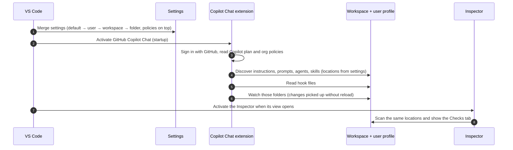
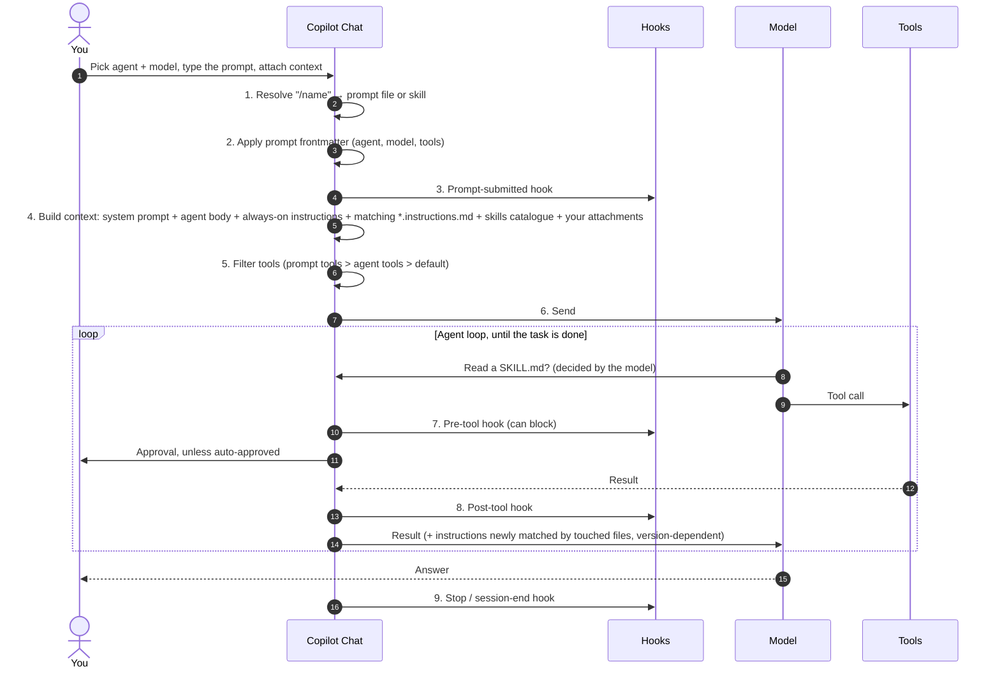

# Rules and Orders — how Copilot resolves and triggers its customisations

This page explains **when** each kind of file checked by the Inspector is loaded, **what decides** that it applies to a request, **in which order** it reaches the model, and **how you can verify** what was actually used.

It covers the seven categories of the Checks tab: Instructions, Skills, Prompts, Agents, Copilot Hooks, Extensions and Settings.

> **Scope and accuracy.** This describes GitHub Copilot Chat in VS Code (agent mode, late 2026), with notes on Claude Code where the Inspector also reads its files. Copilot evolves fast: setting names, hook event names and diagnostics views change between versions. Where behaviour is not documented or not guaranteed, this page says so. Check the [VS Code Copilot customisation docs](https://code.visualstudio.com/docs/copilot/copilot-customization) when in doubt.

---

## 1. The one-minute summary

| Category | Loaded when | Applied to a request when | Who decides | Guaranteed? |
|---|---|---|---|---|
| **Extensions** | VS Code starts | Always (they *are* Copilot) | VS Code | Yes |
| **Settings** | VS Code starts, live on change | Always | VS Code (precedence rules) | Yes |
| **Instructions** — `copilot-instructions.md`, `AGENTS.md` | Discovered at start, re-read on change | Every chat request | VS Code | Sent: yes. Obeyed: up to the model |
| **Instructions** — `*.instructions.md` | Discovered at start, re-read on change | A file in the chat context matches `applyTo` | VS Code (glob match) | Sent: yes when matched. Obeyed: up to the model |
| **Skills** | Name + description listed at start of each request | The model judges the request matches the `description` | **The model** | No |
| **Prompts** | Discovered at start | You type `/name` or run it | **You** | Yes |
| **Agents** (`*.agent.md`) | Discovered at start | You pick it in the agent dropdown (or a prompt / handoff selects it) | **You** | Yes |
| **Copilot Hooks** | Read at session start | The matching lifecycle event happens | VS Code / the agent runtime | **Yes — deterministic** |

The three columns that matter most:

- **Who decides** — VS Code (rules), you (explicit choice), or the model (judgement). Only the last one is unpredictable.
- **Sent vs obeyed** — VS Code can guarantee that an instruction is *sent*; nothing guarantees the model *follows* it. If a rule must always hold, use a hook.
- **Hooks are the only deterministic layer.** Everything else is context given to a probabilistic model.

---

## 2. At launch: what happens when VS Code opens the workspace



Nothing is sent to the model at launch. Launch only builds the **catalogue** of what *could* be used. Files are matched and injected later, per request.

### 2.1 Extensions

- VS Code activates each extension from its `activationEvents`. GitHub Copilot Chat activates at startup; the Inspector activates when you open its view.
- An extension that is disabled for this workspace, not installed, or out of date silently disables everything below it: no instructions, prompts, agents or skills are loaded.
- `.vscode/extensions.json` *recommendations* only suggest extensions; they install nothing.
- The old `GitHub.copilot` extension is deprecated; `GitHub.copilot-chat` provides chat, agent mode and the loading of all customisation files.

### 2.2 Settings — precedence

From lowest to highest priority; the later one wins for the same key:

1. Default values
2. **User** settings (`settings.json` in your profile)
3. Remote settings (SSH, WSL, Codespaces)
4. **Workspace** settings (`.vscode/settings.json`)
5. Workspace **folder** settings (multi-root workspaces)
6. **Policies**: organisation-managed settings and GitHub Copilot organisation/enterprise policies (e.g. MCP or preview features disabled). These override everything and cannot be changed locally.

Inside each level, a language-specific block (`"[apex]": { … }`) overrides the general value for that language.

Settings decide *where* the other files are searched and *whether* some are used at all, for example:

| Setting | Effect |
|---|---|
| `github.copilot.chat.codeGeneration.useInstructionFiles` | Use `.github/copilot-instructions.md` |
| `chat.instructionsFilesLocations` | Folders searched for `*.instructions.md` |
| `chat.promptFilesLocations` | Folders searched for `*.prompt.md` |
| `chat.useAgentsMdFile` | Use `AGENTS.md` as instructions |
| `github.copilot.enable` | Inline suggestions on/off per language (chat is not affected) |

> **Inspector note.** The Settings check only counts keys starting with `github.copilot` or `copilot`; `chat.*` keys are not counted.

### 2.3 Discovery locations

| Category | Workspace | Personal (all workspaces) |
|---|---|---|
| Always-on instructions | `.github/copilot-instructions.md`, `AGENTS.md` (root) | — |
| Scoped instructions | `.github/instructions/*.instructions.md` + `chat.instructionsFilesLocations` | `prompts` folder of the VS Code user profile |
| Prompts | `.github/prompts/*.prompt.md` + `chat.promptFilesLocations` | `prompts` folder of the user profile |
| Agents | `.github/agents/*.agent.md` | user profile |
| Skills | `.github/skills/`, `.claude/skills/`, `.agents/skills/` | `~/.copilot/skills/`, `~/.claude/skills/`, `~/.agents/skills/` |
| Hooks | `.github/hooks/*.json`, `.claude/settings.json`, `.claude/settings.local.json` | user-level hook settings |

**Duplicates.** If the same skill, prompt or agent name exists in two places (workspace and personal, or `.github/skills` and `.claude/skills`), which copy wins is not documented as a stable rule. Keep names unique; the Inspector lists every copy so you can spot duplicates.

**Multi-root workspaces.** Each workspace folder is scanned. A file only applies to the folder it lives in when its `applyTo` glob is relative to that folder.

---

## 3. Per request: the full order of resolution

This is the "cinematic" of one chat request in agent mode.



### Step by step

1. **Slash command resolution.** `/name` is matched against built-in commands, prompt files and skills. A prompt file runs its body as the prompt; a skill is loaded directly instead of waiting for the model to choose it.
2. **Prompt frontmatter overrides the pickers for this one run.** `agent:` switches the agent, `model:` the model, `tools:` the tool list.
3. **Prompt-submitted hook** (`userPromptSubmitted` in the Copilot format, `UserPromptSubmit` in the Claude format). It can log the prompt or add context.
4. **Context assembly.** Everything below is concatenated; there is **no override between instructions**. If two instructions contradict each other, the model chooses, unpredictably.
   1. Copilot's built-in system prompt.
   2. The body of the selected **custom agent**, if any.
   3. **Always-on instructions**: `.github/copilot-instructions.md`, `AGENTS.md`.
   4. **Scoped instructions** whose `applyTo` matches a file in the chat context (see §4).
   5. The **skills catalogue**: only the `name` and `description` of each skill, not their bodies.
   6. Your explicit context: attached files, `#selection`, `#codebase`, instructions added with Add Context.
5. **Tool filtering**, highest priority first:
   1. `tools` of the prompt file
   2. `tools` of the agent named in the prompt file
   3. `tools` of the selected custom agent
   4. Default tools of the built-in agent (Ask, Edit, Agent, Plan)
6. **The model works in a loop.** At each step it may read a `SKILL.md` because the request matches its description, then read files from the skill's `references/` or `assets/` folders. It may also call tools.
7. **Pre-tool hook** before each tool call. It can deny the call, for example a deploy to production. Then comes your approval, unless the tool is auto-approved.
8. **Post-tool hook** after each call, for example to run Prettier or a linter on the edited file.
9. **Stop / session-end hook** when the answer is finished.

---

## 4. Glob rules for `applyTo`

```yaml
---
applyTo: "force-app/**/classes/**/*.cls,**/*.trigger"
description: Apex coding standards
---
```

| Rule | Detail |
|---|---|
| Relative to | The workspace folder root |
| `**` | Any number of folders, including none |
| `*` | Any characters inside one path segment |
| Several patterns | Comma-separated in one string |
| `applyTo: "**"` | Applies to every request that has any file in context; use sparingly |
| No `applyTo` | Never applied automatically; only when attached by hand, or loaded by the agent from its `description` in versions that support it |
| What is matched | **File paths in the chat context**: attached files and files the agent reads or edits (the active editor in some versions). **Not** the words of your prompt |

**Salesforce patterns**

| Goal | Pattern |
|---|---|
| All Apex | `**/*.cls,**/*.trigger` |
| Apex tests only | `**/*Test.cls,**/*_Test.cls` |
| LWC | `**/lwc/**` |
| Aura | `**/aura/**` |
| Flows | `**/*.flow-meta.xml` |
| Permission sets | `**/*.permissionset-meta.xml` |

**Common mistakes**

- `*.cls` without `**/` only matches files at the root of the workspace; write `**/*.cls`.
- "Explain the Opportunity trigger" with no file attached: no file is in context, so `**/*.trigger` instructions are not sent. Attach the file or let the agent open it first.
- Backslashes on Windows: globs always use `/`.

---

## 5. Agent vs Skill — why they look alike and how they differ

Both are Markdown files with YAML frontmatter, both have a `description`, and both can be started by name. They answer different questions:

- An **agent** changes **who** Copilot is for the whole conversation.
- A **skill** teaches Copilot **how** to do one task, loaded only when that task comes up.

| | Custom agent (`*.agent.md`) | Skill (`{name}/SKILL.md`) |
|---|---|---|
| Question it answers | Who is working, with which tools? | How is this task done? |
| Who activates it | **You**: agent dropdown, a prompt's `agent:`, or a handoff | **The model**, from the `description` (or you with `/name`) |
| How long it lasts | The whole conversation, until you switch | One task; read when needed |
| How it is loaded | Its whole body is in the system prompt for every request | Progressive: only name + description at first, then `SKILL.md`, then `references/` and `assets/` files on demand |
| Context cost | Paid on every request | Small until used |
| Tool control | `tools:` **restricts** what the agent can do | `allowed-tools` is advisory, if supported at all |
| Can pick a model | Yes (`model:`) | No |
| Extra files | No (links only) | Yes: `references/`, `assets/`, `scripts/` |
| Shape | A single file | A folder |
| Portability | VS Code / GitHub Copilot format | Open standard (agentskills.io), also used by Claude Code and other agents |
| Typical Salesforce use | "Apex Reviewer" (read-only), "Deployer" with the Salesforce MCP tools | "Generate Apex tests", "Analyse a debug log", "Write a trigger handler" |

They combine: a custom agent can use skills. An "Apex Reviewer" agent limited to read tools can still read the `apex-code-review` skill, but it cannot edit files even if the skill tells it to.

**Not to confuse**

- **`AGENTS.md` is not an agent.** It is an always-on *instructions* file, read by Copilot and by other coding agents. It never changes the persona or the tools.
- **Prompt vs skill.** Both can be started with `/name`. A prompt is a canned *request* that you start yourself; it never fires automatically. A skill is *know-how* that the model can also pick up on its own.
- **Instructions vs skill.** Instructions are rules that always apply (or whenever a glob matches). A skill is a procedure that applies only when the task matches. "Never put SOQL in a loop" is an instruction; "how to write a test class with our data factory" is a skill.

**Which one should I write?**

```text
Must it ALWAYS happen, no exceptions?          → Hook
Is it a rule for every answer or file type?    → Instructions (applyTo for file types)
Is it a procedure needed only for some tasks?  → Skill
Is it a request I run myself, often?           → Prompt
Is it a role with its own tools for a session? → Custom agent
```

---

## 6. Worked examples

The examples assume this workspace:

```text
.github/
  copilot-instructions.md               always on
  instructions/apex.instructions.md     applyTo: "**/*.cls,**/*.trigger"
  instructions/lwc.instructions.md      applyTo: "**/lwc/**"
  prompts/new-trigger-handler.prompt.md agent: agent, tools: [edit, search, runInTerminal]
  agents/apex-reviewer.agent.md         tools: [search, usages, problems]  (read-only)
  skills/platform-apex-test-generate/   description: "...unit tests... Use when the user asks for tests or coverage"
  hooks/guard.json                      preToolUse: block "sf project deploy" to production
                                        postToolUse: run prettier on edited files
AGENTS.md                               build / deploy commands
```

### Example A — "Add a test class for AccountService" (Agent mode, `AccountService.cls` open)

| Step | What is triggered | Why |
|---|---|---|
| 1 | `copilot-instructions.md`, `AGENTS.md` | Always on |
| 2 | `apex.instructions.md` | `AccountService.cls` is in context and matches `**/*.cls` |
| 3 | `lwc.instructions.md` | **Not** triggered: no LWC file in context |
| 4 | Skills catalogue | Sent (names + descriptions only) |
| 5 | `platform-apex-test-generate` | The model sees "tests" in the request, matching the description, and reads `SKILL.md`, then `assets/…Test.cls` |
| 6 | Create-file tool → `guard.json` pre-tool hook | Allowed (not a deploy) |
| 7 | Post-tool hook | Prettier formats `AccountServiceTest.cls` |
| 8 | Terminal tool `sf apex run test …` → pre-tool hook | Allowed; you approve the command unless it is auto-approved |

### Example B — `/new-trigger-handler Opportunity` (from Ask mode)

| Step | What is triggered | Why |
|---|---|---|
| 1 | Prompt file `new-trigger-handler.prompt.md` | You typed `/new-trigger-handler` |
| 2 | **Agent mode** for this run, even though Ask was selected | Prompt frontmatter `agent: agent` |
| 3 | Tool list = `edit, search, runInTerminal` | Prompt `tools` have the highest priority |
| 4 | Always-on instructions | As always |
| 5 | `apex.instructions.md` | Only once the agent creates or opens a `.trigger` or `.cls` file, if your VS Code version re-evaluates `applyTo` during the loop. Otherwise attach a `.cls` file to the request to be sure |
| 6 | Hooks | On each edit and terminal call |

### Example C — "Review OpportunityTriggerHandler.cls", with the **Apex Reviewer** agent selected

| Step | What is triggered | Why |
|---|---|---|
| 1 | `apex-reviewer.agent.md` body + always-on instructions | You selected the agent |
| 2 | `apex.instructions.md` | The `.cls` file is attached |
| 3 | Tools limited to `search, usages, problems` | Agent `tools` |
| 4 | A review skill, if one exists | The model may read it |
| 5 | **No edits possible** | Edit tools are filtered out, even if the skill says "fix the issue" |
| 6 | Pre/post-tool hooks | Still fire for every read tool call |

### Example D — "Why didn't my LWC rules apply?"

Prompt: "Make the account card responsive", with nothing attached and the cursor in an Apex file.

- `lwc.instructions.md` was **not** sent: no file matching `**/lwc/**` was in context at the start.
- `apex.instructions.md` **may** have been sent because the active Apex file was in context, which is the opposite of what you wanted.
- Fix: attach `force-app/main/default/lwc/accountCard/accountCard.js` (or `#file:`), or restate the rule in the prompt.

---

## 7. How to verify what was triggered

There is **no single official trace** that lists everything and explains *why* something was or was not used. Combine these sources, from most to least reliable.

| What you want to know | How | Reliability |
|---|---|---|
| Was a hook executed? | Make the hook append a timestamped line to a log file | **Certain** |
| Which files exist and are valid? | Inspector → **Checks** tab, and **check** on each skill | Certain (static) |
| Was an instructions file sent? | Expand **References** / "Used n references" under the answer: instructions files are listed | High |
| What exactly was sent to the model? | Chat Debug view (Command Palette: *Show Chat Debug View*): full system prompt, instructions, tool list | High (when available in your version) |
| Which customisations were loaded, with errors? | Chat view **⋯ / right-click → Diagnostics**: lists the agents, prompts, instructions and skills that were found, and parsing errors | High (recent versions) |
| Was a skill read? | The answer shows **"Reading skill [name]"** | High |
| Which skills are used, over time? | Inspector → 📈 **Usage** (Skill Usage Monitor) parses those "Reading skill" lines from your chat history | High (after the fact) |
| Which tools ran? | The tool-call blocks in the answer, and the approval prompts | High |
| Low-level details | Output panel → *GitHub Copilot Chat*, log level set to Trace | Medium (verbose) |
| Did the model *follow* an instruction? | Canary rule: add "End every answer with `[apex-instr]`" to the file, then remove it | Medium: proves it was sent *and* followed this time |
| "What instructions do you have?" asked to the model | — | **Low**: it may summarise, omit or invent |

### Hook logging example

`.github/hooks/trace.json`:

```json
{
  "version": 1,
  "hooks": {
    "sessionStart": [{ "type": "command", "bash": "echo \"$(date -Is) sessionStart\" >> .hooks.log", "powershell": "Add-Content .hooks.log \"$(Get-Date -Format o) sessionStart\"" }],
    "preToolUse":   [{ "type": "command", "bash": "echo \"$(date -Is) preToolUse\"   >> .hooks.log", "powershell": "Add-Content .hooks.log \"$(Get-Date -Format o) preToolUse\"" }]
  }
}
```

Add `.hooks.log` to `.gitignore`. The event details (tool name, arguments) arrive as JSON on standard input if you want to log them too.

### Claude Code

The Inspector also reads `.claude/` files. In Claude Code:

| Question | Command |
|---|---|
| What is in context (memory files, skills, tools, MCP)? | `/context` |
| Which hooks are configured? | `/hooks` |
| Which memory files (`CLAUDE.md`) are loaded? | `/memory` |
| Which skills are used or unused? | `/skill-doctor`, or the Inspector's Usage panel (reads `~/.claude/projects/**/*.jsonl`) |

### What you cannot fully verify

- **Why the model did *not* pick a skill.** Only the outcome is visible. Improve the `description` (what + "Use this skill when…") and test with typical prompts.
- **Whether an instruction was followed everywhere.** Being sent is visible; compliance is not guaranteed. Turn critical rules into hooks or CI checks (Code Analyzer, PMD, Apex tests).
- **The exact order inside the system prompt.** It is an implementation detail that can change between versions; do not rely on one instruction "coming after" another.

---

## 8. Checklist when something is not triggered

1. **Extensions**: Copilot Chat installed, enabled, up to date, signed in (Inspector → Extensions).
2. **Settings**: the feature is enabled and the file's folder is in the `*Locations` setting; no organisation policy blocks it.
3. **Location and name**: right folder, right suffix (`.instructions.md`, `.prompt.md`, `.agent.md`, `SKILL.md` in a folder with the same name as `name:`).
4. **Frontmatter**: valid YAML, quoted strings that contain `:` (Inspector → **check** on skills).
5. **Instructions**: `applyTo` uses `**/` and matches a file that is *in the chat context*.
6. **Skills**: agent mode; the `description` contains the words users actually type; no duplicate name in another skills folder.
7. **Agents and prompts**: the `tools` list contains the tools the task needs.
8. **Hooks**: valid JSON (Inspector shows a warning otherwise), script executable, fast enough to finish before the timeout.
9. **Reload** the window if a file was created outside VS Code and is still not listed in Diagnostics.
